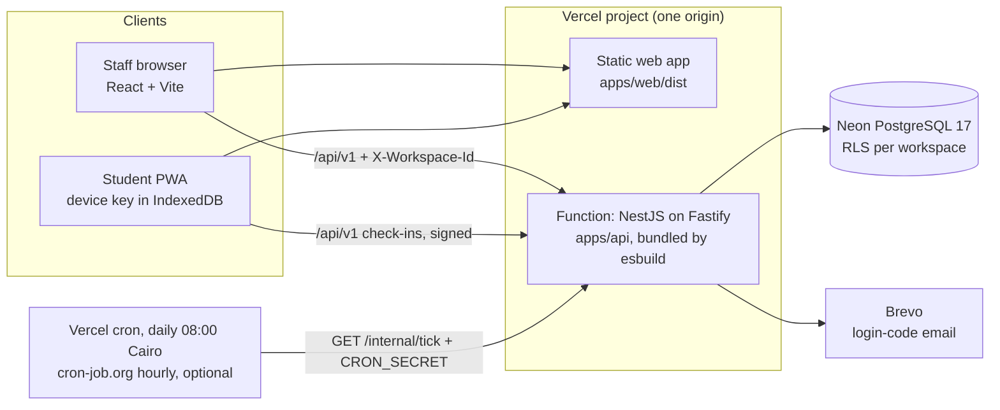

# Dafter (دفتر)

A bilingual (Arabic-first, English) multi-tenant SaaS for Egyptian tutoring centers and independent teachers. It covers groups and a weekly timetable, students with their own installable app, rotating-QR attendance, fees with printable receipts, and parent messages.

Built solo as a portfolio piece. v0 is a working demo, not a product in use yet.

**Live demo:** https://dafter-vert.vercel.app

| Role | Phone | Password |
|:--|:--|:--|
| Owner | <bdi>01000000001</bdi> | `dafter-dev-123` |
| Teacher | <bdi>01000000002</bdi> | `dafter-dev-123` |
| Assistant | <bdi>01000000003</bdi> | `dafter-dev-123` |

The demo data is public and anyone can change it. Parent messages show up on `/dev/phone` instead of WhatsApp. The first request after a quiet spell takes about 1–2 s (cold start).

## What it does

- **Workspaces:** a center or a single teacher. Staff roles are owner, teacher and assistant. Staff join by single-use invites, and assistants can be limited to certain teachers.
- **Groups and timetable:** groups use the Egyptian curriculum (subjects, grade levels) and have weekly slots. Sessions are generated 4 weeks ahead in Cairo time, and a session can be cancelled or moved.
- **Students:** Arabic-aware search, so «احمد» finds «أحمد», plus search by student or parent phone and a warning for duplicate phones. Siblings share one parent.
- **Student app:** an installable PWA. The student activates with an invite link and a 6-digit code sent by email, and the phone is bound with a WebCrypto key that can't be extracted.
- **Attendance:** the teacher's screen shows a QR code that changes every 10 s. The student scans it with the bound phone, and check-ins show up live. Closing the session marks everyone else absent, and the assistant can mark attendance by hand.
- **Fees:** monthly charges and payments go into an append-only ledger in integer piastres. Mistakes are fixed with reversal entries, and receipts are print-ready.
- **Parent messages:** absence, cancelled and moved-session messages in Arabic or English, with quiet hours, merged messages for siblings, per-center switches and a message log.

## Architecture



- **Monorepo:** pnpm and Turborepo. `apps/api` (NestJS), `apps/web` (React), `packages/contracts` (Zod → OpenAPI → RTK Query client), `packages/db` (Drizzle schema, migrations, seeds), `packages/i18n`, `packages/config`, `e2e/` (Playwright).
- **Contract first:** Zod schemas in `packages/contracts` produce the OpenAPI file and the typed web client. The API returns error codes such as `ATTENDANCE_ALREADY_RECORDED`, never sentences, and the web app translates them.
- **Two run modes from one codebase:** an always-on mode with `main.ts` plus a pg-boss worker (jobs in PostgreSQL, no Redis), and a serverless mode on Vercel. On Vercel, messages are sent right after the write that queues them, a cron tick runs the daily jobs, and the live list polls the database every second.

## Key decisions

The full records, with the alternatives considered, are in [`docs/decisions.md`](docs/decisions.md).

1. **Tenant isolation in layers.** Every query goes through a tenant-scoped repository that runs `SET LOCAL ROLE dafter_app` and `set_config('app.workspace_id', …)` in its transaction. PostgreSQL RLS is the backstop: with no workspace set, a query returns no rows. Generated test suites fail if a new route lacks the tenant guard or a new table lacks RLS.
2. **Staff auth.** A 15-minute access JWT is kept in memory. The refresh token sits in an httpOnly `SameSite=Strict` cookie, is stored hashed and rotates on every use. If a rotated token is reused, its whole token family is revoked.
3. **Students prove the phone, not a password.** The student logs in with an email code. The phone holds a P-256 private key that can't be extracted, and every check-in is signed with it. Login and binding happen only inside the installed PWA, because iPhone Safari keeps the browser's storage and the installed app's storage apart.
4. **Rotating QR without a stored key.** The session key is `HMAC(QR_SECRET, sessionId)`. A check-in is checked in this order: the MAC first (no database read for forged codes), then the 10 s window (current or previous), then the device signature, then whether the session is open. The unique (session, student) row makes repeated scans safe.
5. **Money in an append-only ledger.** Amounts are signed integer piastres, and `UPDATE` and `DELETE` are revoked at the database level. Payments and reversals need an `Idempotency-Key`, which is stored on the ledger entry together with a hash of the request.
6. **Transactional outbox.** Each message row is written in the same transaction as the event (a session closed, cancelled or moved), with a unique `dedupe_key`, so one real event gives exactly one row. Quiet hours are computed in SQL in the workspace's timezone.
7. **Free hosting without a card.** Render, Koyeb, Fly.io and Hugging Face were ruled out, because they need a card or are now paid. Vercel Hobby serves the web app and the API from one origin, so the refresh cookie works without CORS. The always-on mode stays in the code for a VPS later.
8. **Arabic first.** RTL is the default, and the code uses only logical Tailwind classes (lint enforces this). Every string has an `ar` and an `en` key (checked in CI). Numbers and phones go inside `<bdi>`. One shared normalize function is used on save and on search.

## Run it locally

Requirements: Node 22.12+, pnpm 11, Docker.

```bash
pnpm install
cp .env.example .env
pnpm db:reset   # PostgreSQL 17 in Docker, migrations, seed
pnpm dev        # API, worker and web app at http://localhost:5173
```

| Command | What it does |
|:--|:--|
| `pnpm test` | Lint, format check, typecheck, unit and integration tests, i18n key check |
| `pnpm e2e` | Playwright end-to-end tests in Arabic and English (reuses `pnpm dev` or starts it) |
| `pnpm e2e:live` | Read-only smoke test against a deployed URL (`E2E_BASE_URL`) |
| `pnpm contracts:gen` | Regenerate the OpenAPI file and the RTK Query client |
| `pnpm db:generate` | New Drizzle migration from the schema |
| `pnpm db:seed:demo` | Arabic demo center: 3 groups, 12 students, 2 past weeks of attendance |

In development, login codes print to the API console. Parent messages show up on `/dev/phone`.

To deploy, follow [`docs/deploy.md`](docs/deploy.md). It covers Vercel, Neon and Brevo, all on free plans with no card.

## Test strategy

| Layer | Tool | What it covers |
|:--|:--|:--|
| Unit | Vitest | Arabic normalize, QR window math (browser vs server), money parsing, templates, error format, the web `baseQuery` refresh |
| Integration | Vitest + Testcontainers | Each test file gets its own copy of a migrated template database. Covers every endpoint, refresh-token reuse, RLS, parallel payments, exactly-once outbox and quiet hours |
| Isolation | Generated suites | Finds every route from Nest metadata and every tenant table from `information_schema`. Fails if a route skips the tenant guard or a table has no RLS |
| End to end | Playwright | User flows in `ar` and `en` at 375 px. Teacher and student run in two browser contexts with fake time. Every test checks for console errors and horizontal scroll |
| Live | Playwright (`e2e:live`) | Sign-in and workspace switch against the deployed URL after each deploy |

Last full run (Nov 13, 2026): **162** unit and integration tests (API 136, db 13, web 10, i18n 3) and **20** Playwright tests (10 flows × ar, en), all passing.

Domain code never calls `new Date()`. It gets the time from an injected `Clock`, so session generation, late marks, quiet hours and monthly charges are tested with fixed times, including Cairo DST changes.

## Limits

v0 is a demo. Everything known to be missing, unchecked or simplified is listed in [`docs/known-limits.md`](docs/known-limits.md). The main items:

- Vercel Hobby is for non-commercial use, and there is no always-on worker, so failed messages wait for the next cron tick.
- Parent messages go to a fake phone page. WhatsApp isn't connected.
- The real camera, PWA install and phone binding have not yet been tried by hand on a real iPhone and Android phone.
- There is no unpaid report or proration yet. The fee model waits for interviews with centers.

## Docs

[`product.md`](docs/product.md) · [`architecture.md`](docs/architecture.md) · [`data-model-api.md`](docs/data-model-api.md) · [`bilingual-messaging.md`](docs/bilingual-messaging.md) · [`testing-ci.md`](docs/testing-ci.md) · [`decisions.md`](docs/decisions.md) · [`known-limits.md`](docs/known-limits.md) · [`deploy.md`](docs/deploy.md) · [`demo-script.md`](docs/demo-script.md) · [`progress.md`](docs/progress.md)
